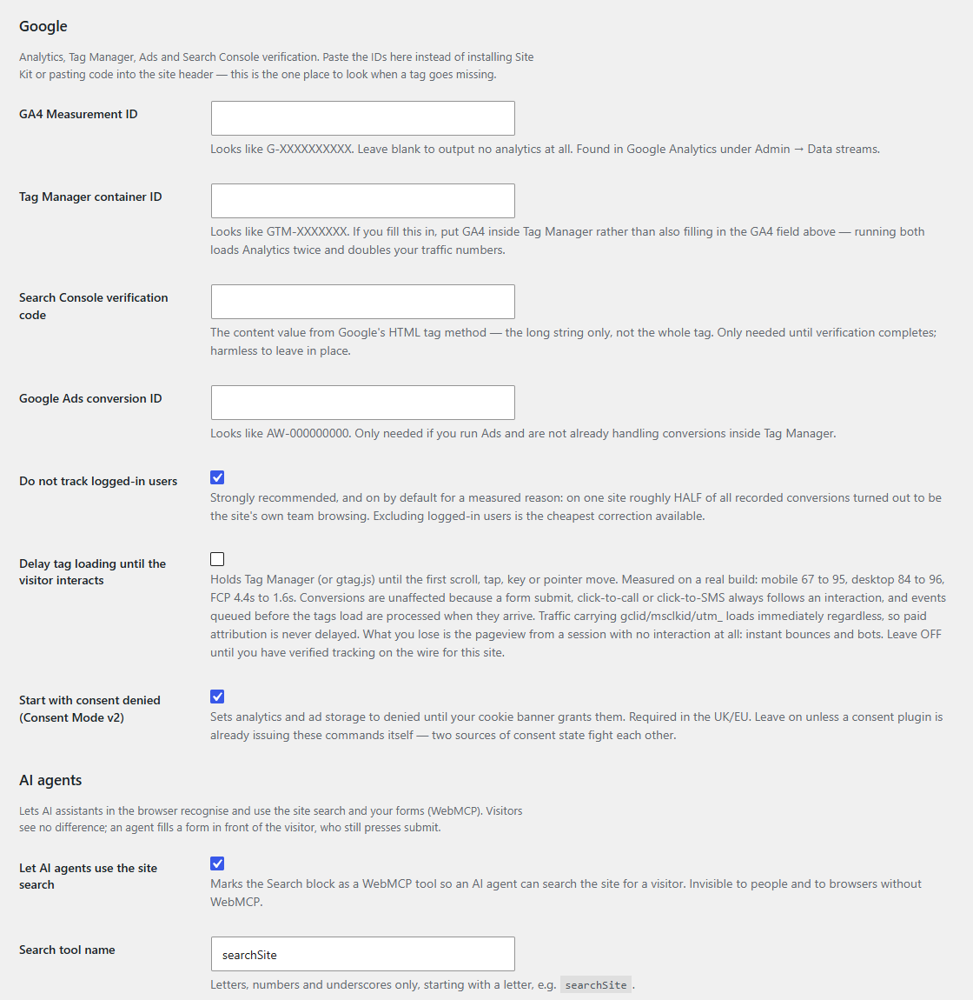

# AJR Starter Core

The core plugin half of the AJR Starter Kit: a WordPress plugin scaffold where **everything the plugin does is a setting**. It pairs with [AJR Starter Theme](https://github.com/andrew-ajrwebdesign/ajr-starter-theme), a full-site-editing block theme.

Every site I build ships as two pieces. The theme owns how the site looks; this plugin owns what must survive a theme change: business details and schema, Google tags, the redirect map, image sizes, comments, an optional custom post type, and AI-agent access. Each piece is a module you can delete in one line.

[](https://playground.wordpress.net/?blueprint-url=https://raw.githubusercontent.com/andrew-ajrwebdesign/ajr-starter-theme/main/blueprint.json)



## The rules it is built on

1. **Nothing is hardcoded.** Every value lives in one schema (`Core\Config::schema()`) with its label, type, group and default. The settings screen is generated from that schema, so a new setting gets its admin field for free. `bin/check-hardcoded.mjs` runs in CI and fails the build if a feature class contains a phone number, email address, postcode or third-party URL.
2. **One option row.** All settings are one autoloaded array, never one `wp_options` row per field.
3. **Modules, not a framework.** Each feature is a class with a `register()` method, listed once in `Core\Plugin::modules()`. Deleting a feature means deleting its file and that line.
4. **Replace plugins rather than add them.** Tags replaces Site Kit and header-snippet plugins. Comments replaces Disable Comments. Redirects replaces a redirect plugin. The site has fewer plugins to update and audit, and fewer places a setting can hide.
5. **No runtime dependencies.** No `vendor/` ships. A built-in PSR-4 autoloader means an FTP upload or a fresh clone works with no build step. Composer is only for the dev tooling.
6. **The comments explain why.** The code is commented at length on purpose. Each docblock says what went wrong on a real build before the code took its current shape, so the next person doesn't undo the fix.

## What is in it

| Module | What it does |
|---|---|
| `Google\Tags` | GA4, Tag Manager, Ads and Search Console verification from settings. Consent Mode v2 defaults to denied, logged-in users are excluded, and tags can wait for the first interaction. Campaign traffic (gclid, utm_*) always loads tags at once, so paid attribution is never lost. |
| `Schema\Business_Profile` | LocalBusiness/Organization JSON-LD built from the business details. It falls back to Organization while there is no address, so the markup never fails Google's required-field check. |
| `Seo\Redirects` | A redirect map you edit as plain text, one rule per line. It is parsed once and cached. Off-site targets are allowed only if they appear in the map, so it can't be used as an open redirect. |
| `Media\Image_Sizes` | Fills the gaps in core's responsive image sizes so `srcset` can pick a closer match. These sizes live in the plugin because they have to survive a theme change. |
| `Site\Comments` | Turns comments off completely: front end, admin, feeds and REST. |
| `PostTypes\Content_Type` | An optional custom post type. Its slug and labels are settings, and rewrites flush when any of them change. |
| `Agents\WebMCP_Forms` | WebMCP annotations so AI agents can use the site search and named forms. Lead forms are never auto-submitted. |
| `Agents\Llms_Txt_Scope` | Keeps cart, checkout and account pages out of `llms.txt`. |
| `Admin\Agent_Access` | Creates a REST application password for tooling from the settings page. It is shown once and can be revoked. |
| `Admin\Settings` | The settings screen, generated from the schema. |

## Starting a project from it

1. Copy the repo (use it as a template, or `git clone` and then delete `.git`).
2. Rename it. There are four find-and-replaces, in this order, and then you rename the folder and the main file:

   | Find | Replace with | What it is |
   |---|---|---|
   | `AJR Starter Core` | `Acme Core` | display name |
   | `ajr-starter-core` | `acme-core` | slug, text domain, folder, file name |
   | `ajr_starter_core` | `acme_core` | **underscore form**: the option name and filter hooks |
   | `AJR_STARTER_CORE` | `ACME_CORE` | constants |
   | `AJR\StarterCore` | `AJR\Acme` | namespace (also in `composer.json`) |

   A hyphen-based find-and-replace misses the underscore form. If you miss it, two sites that share a database (a multisite or a shared staging install) read each other's settings. Check both forms afterwards:

   ```bash
   grep -rn 'ajr-starter\|ajr_starter\|AJR_STARTER\|StarterCore' . --exclude-dir=vendor
   ```

3. Delete the modules this site doesn't need: remove the file and its line in `Core\Plugin::modules()`.
4. Activate it, then fill in **Settings → Site Settings**.

## Development

```bash
composer install
composer phpcs                  # WordPress Coding Standards (phpcs.xml)
composer test                   # PHPUnit + WP_Mock unit tests
node bin/check-hardcoded.mjs    # the no-literals gate
node bin/verify-defer-gate.cjs  # browser test of the tag-deferral gate (needs playwright-core)
```

CI runs PHPCS, PHPUnit on PHP 8.1, 8.2 and 8.3, and the hardcoded-value check on every push and pull request. `.wp-env.json` lets `npx @wordpress/env start` run a local WordPress with the plugin mounted.

Requires WordPress 6.7+ and PHP 8.1+.

## License

GPL-2.0-or-later. See [LICENSE](LICENSE).

Built by [AJR Web Design](https://ajrwebdesign.com).
